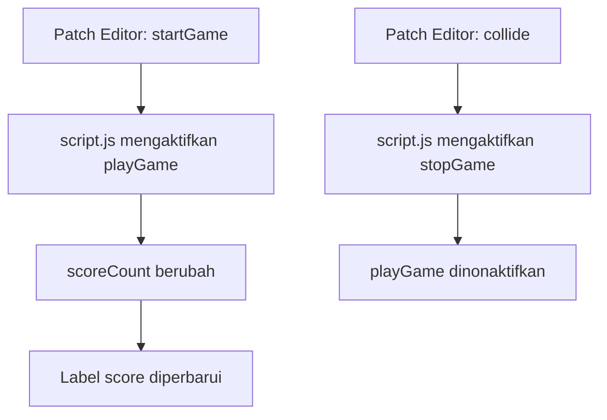

# Mini Game Interaktif Spark AR

Repository ini berisi project Spark AR (`tubesSismul.arproj`), patch, script, texture, dan file export. Script JavaScript menghubungkan event dari Patch Editor dengan tampilan skor dan status permainan.

## Alur interaksi

Script mencari objek scene bernama `score` dan membaca event `startGame`, `collide`, serta nilai `scoreCount`. Logika permainan utama dihubungkan melalui patch Spark AR.

## Membuka project

1. Pasang Spark AR Studio yang kompatibel dengan format project.
2. Buka `tubesSismul/tubesSismul.arproj`.
3. Periksa koneksi patch di Patch Editor dan jalankan preview di Spark AR Studio.
4. Gunakan `tubesSismul.arexport` atau file ZIP yang disertakan sebagai artefak export bila diperlukan.

## Struktur penting

- `tubesSismul/scripts/script.js`: sinkronisasi event patch, skor, dan status permainan.
- `tubesSismul/patches/Detect collide.arp`: patch deteksi collision.
- `tubesSismul/textures/`: aset visual yang dipakai project.

Project ini memerlukan Spark AR Studio dan konfigurasi patch yang sesuai; tidak dijalankan sebagai website atau aplikasi Node.js biasa.
